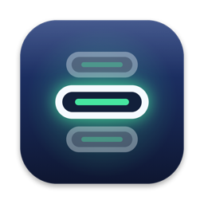
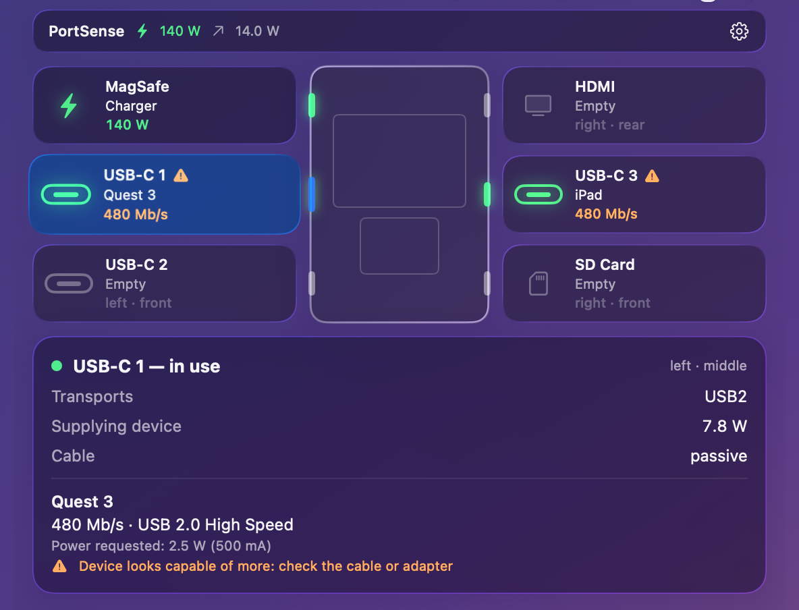
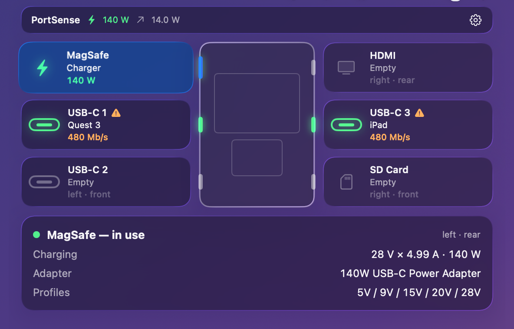
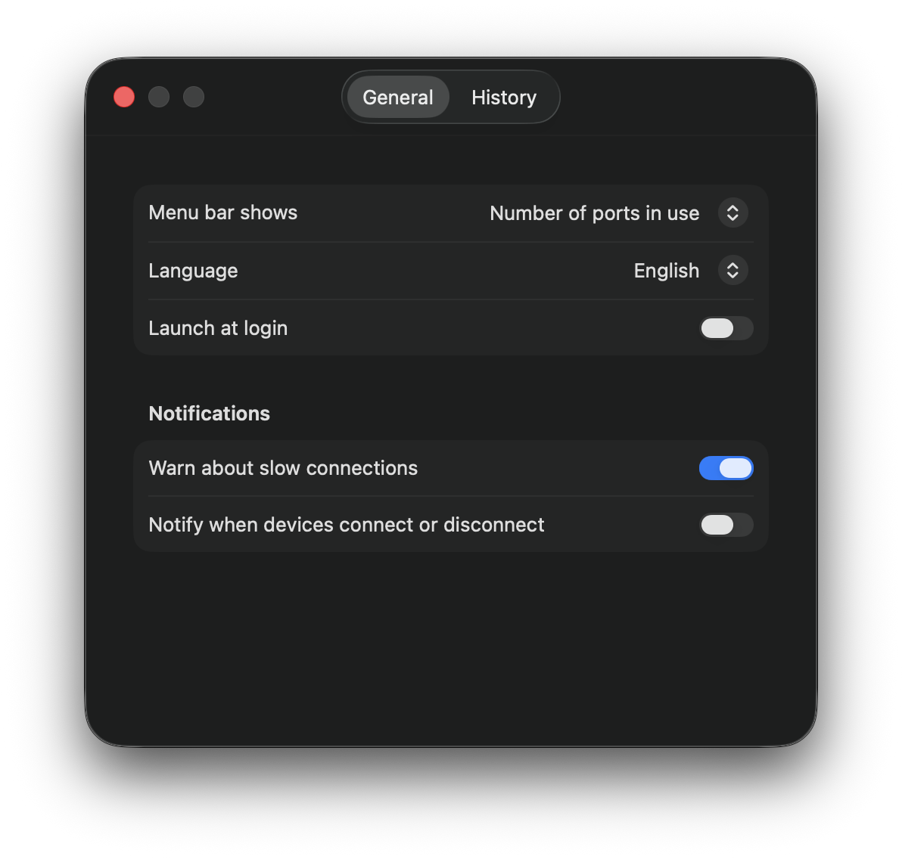

<p align="center">
  
</p>

<h1 align="center">PortSense</h1>

<p align="center">
  A menu bar app that shows what is plugged into every port of your Mac —<br>
  link speed, charging power, and whether a cable is holding a device back.
</p>

<p align="center">
  <a href="https://github.com/mr-akkerman/PortSense/releases/latest"></a>
  
  
  <a href="LICENSE"></a>
</p>

<p align="center">
  
</p>

## Why

macOS knows a lot about your ports and tells you almost none of it. A fast SSD
silently drops to USB 2.0 because of the wrong cable. A charger negotiates less
power than it could. Finding out means digging through System Information.

PortSense puts it one hover away: move the pointer over the menu bar icon and a
diagram of your Mac appears, with every port, what is connected to it and how
well that connection is doing.

## Features

- **A map of your Mac.** Ports are laid out the way they sit on the chassis —
  left and right, rear to front — so you can tell which physical port is which.
- **Every port, not just USB-C.** MagSafe, HDMI and the SD card slot are shown
  alongside the USB-C / Thunderbolt ports.
- **Real link speed.** The negotiated speed of each USB device, with the USB
  standard it corresponds to, including devices behind hubs.
- **Slow connection warnings.** When a device that looks USB 3 capable ends up
  on a 480 Mb/s link, PortSense flags it and can send a notification — usually
  the cable or an adapter is to blame.
- **Charging details.** Charger name and wattage, the negotiated voltage and
  current, and every power profile the charger offers.
- **Power per port.** How many watts each port is supplying to its device.
- **Displays and Thunderbolt.** Video link rate, connected displays and
  Thunderbolt devices on the port they use.
- **Eject from the panel.** External drives get an eject button next to them.
- **History.** A log of connections, disconnections and charger events.
- **Menu bar your way.** Show the number of ports in use, charging power, the
  fastest device speed, or just the icon.
- **English and Russian**, following the system language by default.

<p align="center">
  
</p>

## Install

1. Download the latest `PortSense-x.y.dmg` from
   [Releases](https://github.com/mr-akkerman/PortSense/releases/latest).
2. Open it and drag **PortSense** to **Applications**.
3. Launch PortSense. It lives in the menu bar and has no Dock icon.

Release builds are signed with a Developer ID and notarized by Apple, so macOS
opens them without security warnings. They are universal binaries for Apple
Silicon and Intel and require macOS 14 or later.

## Usage

| Action | Result |
| --- | --- |
| Hover the menu bar icon | The panel appears and hides when you move away |
| Click the icon | Pins the panel until you click elsewhere |
| Hover a port | Shows details for that port |
| Right-click the icon | Refresh, Settings, Launch at login, Quit |
| Gear button in the panel | Opens Settings |

<p align="center">
  
</p>

## Privacy

PortSense makes no network connections and collects nothing. Everything it
shows is read locally from the macOS I/O Registry. Preferences and the history
log are stored on your Mac in the app's own defaults.

## Build from source

You need macOS 14 or later and the Xcode command line tools
(`xcode-select --install`). There is no Xcode project and there are no
dependencies — the app is a handful of Swift files compiled with `swiftc`.

```bash
git clone https://github.com/mr-akkerman/PortSense.git
cd PortSense
./scripts/build.sh
open ~/Applications/PortSense.app
```

`build.sh` produces an ad hoc signed development build and installs it to
`~/Applications`.

To produce a signed and notarized DMG you need a Developer ID certificate and a
`notarytool` keychain profile:

```bash
VERSION=1.2 NOTARY_PROFILE=<your-profile> BUNDLE_ID=com.example.portsense ./scripts/release.sh
```

Run with `NOTARIZE=0` to skip notarization. The script header documents the
remaining options.

## How it works

| File | What it does |
| --- | --- |
| `Sources/Core.swift` | Data model and collection: reads ports, transports, power and USB devices from the I/O Registry |
| `Sources/Store.swift` | App state, preferences, history log and notifications |
| `Sources/Views.swift` | The SwiftUI panel, the chassis diagram and the settings window |
| `Sources/App.swift` | Menu bar item, the floating panel and its show/hide behaviour |
| `scripts/` | Development build, release pipeline and the artwork generator |

Port state comes straight from IOKit, so a full refresh takes roughly a tenth
of a second and the app can poll every couple of seconds. Thunderbolt and
display details are filled in from `system_profiler`.

## Known limitations

- **Port placement is inferred.** The left/right, rear/front layout follows
  the usual MacBook arrangement and port numbering. It was developed on a
  16-inch MacBook Pro (2024) and may be off on other models. Desktop Macs get a plain
  list without the chassis diagram.
- **The slow connection warning is a heuristic.** It relies on what the device
  reports about itself, so an occasional device that genuinely tops out at
  USB 2.0 can be flagged.
- **Display-to-port mapping** is exact only when the number of external
  displays matches the number of ports carrying video. Otherwise all displays
  are listed on each such port.

Reports from other Mac models are very welcome — please
[open an issue](https://github.com/mr-akkerman/PortSense/issues) with your
model and what PortSense shows.

## License

[MIT](LICENSE)
